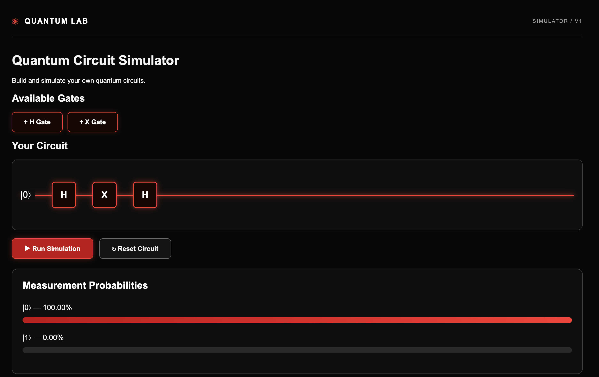

## Getting Started

### Prerequisites

Before running the application, install:

- Java (compatible with the project's Maven configuration)
- Node.js and npm
- Git

### 1. Clone the Repository

```bash
git clone https://github.com/PRINCEXHAIRO/quantum-circuit-simulator.git
cd quantum-circuit-simulator
```

### 2. Start the Backend

```bash
cd quantum-backend
./mvnw spring-boot:run
```

The Spring Boot backend runs at:

http://localhost:8080

### 3. Start the Frontend

Open a second terminal from the main project directory:

```bash
cd quantum-frontend
npm install
npm start
```

Open your browser at:

http://localhost:4200

### 4. Use the Simulator

1. Select H or X gates to build a circuit.
2. Click Run Simulation.
3. View the measurement probabilities.
4. Click Reset Circuit to start again.

## Running Tests

From the `quantum-backend` directory:

```bash
./mvnw test
```
## Screenshot

